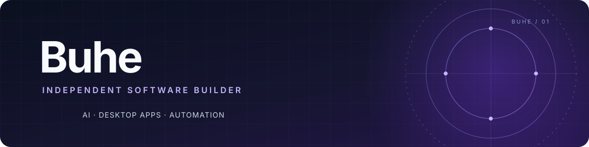

  
   
  
  
  

---

## Hey, I'm Buhe 👋

I'm an independent software builder who enjoys turning ideas into practical products.

I bring together product thinking, design, and AI-assisted development to make software that is useful, approachable, and enjoyable to use.

- 🤖 Exploring AI applications, agents, and MCP
- 💻 Building desktop applications and developer tools
- ⚙️ Simplifying repetitive work through automation
- 🎨 Caring about thoughtful interfaces and smooth interactions

> **Make useful things. Keep them simple. Make them feel good to use.**

## What I Build

| 🤖 AI & Intelligent Tools | 💻 Desktop Software | ⚙️ Automation |
|:---:|:---:|:---:|
| AI applications and agents | Desktop productivity apps | Browser automation |
| MCP and AI workflows | Electron and native integrations | Workflow utilities |
| Practical AI experiences | Tools for everyday work | Removing repetitive tasks |

## Tools & Technologies

  

## Selected Work

### 🎧 [Mineradio](https://github.com/xiaoqi72665/Mineradio)

An immersive Windows desktop music player that brings together weather-based radio, lyrics, particle visuals, and a 3D playlist experience.

- Weather-aware listening and personalized radio
- Lyrics stage and visual effects
- A 3D playlist shelf for a more immersive desktop experience

  
  

## A Little More

I'm always exploring new ideas, learning from open source, and finding better ways to turn concepts into working software.

If something here catches your interest, feel free to explore my repositories or say hello.

---

  Thanks for stopping by. Built with curiosity, creativity, and a little help from AI. ✨

